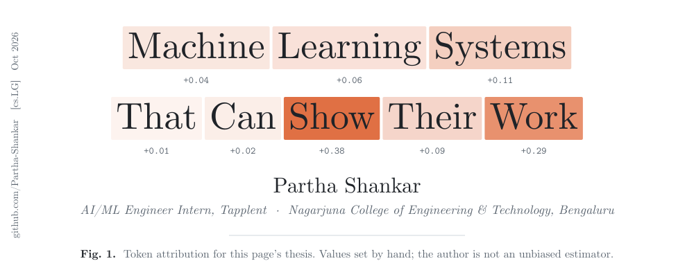
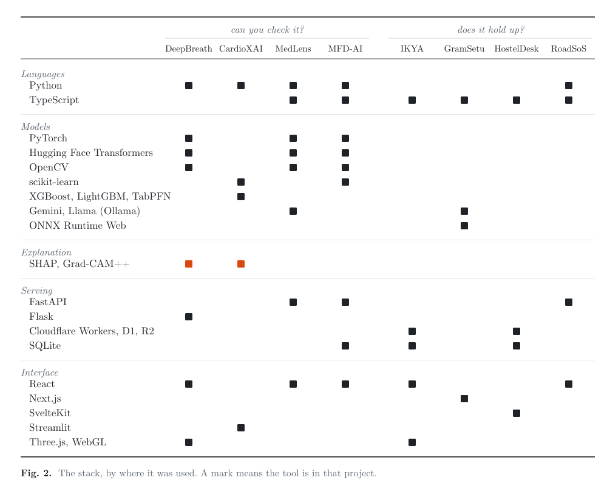

<picture>
  <source media="(prefers-color-scheme: dark)" srcset="assets/fig1-dark.svg">
  
</picture>

<p align="center"><samp>
  <a href="https://parthashankar.pages.dev">portfolio</a> &nbsp;·&nbsp;
  <a href="https://linkedin.com/in/partha-shankar">linkedin</a> &nbsp;·&nbsp;
  <a href="https://leetcode.com/u/parthashankar21">leetcode</a> &nbsp;·&nbsp;
  <a href="mailto:parthashankar21@gmail.com">email</a>
</samp></p>

**Abstract.** I'm a final-year computer science student in Bengaluru and an AI/ML engineer intern at [Tapplent](https://www.tapplent.com), where I work on enterprise RAG. Most of what I build ends up in front of someone who can overrule it: a radiologist, a pharmacist, a network operator, an HR admin. So I spend as much time on the evidence behind an answer as on the answer. I've also had five pull requests merged into Next.js, Hugging Face Transformers, Cloudflare's Workers SDK and Apicurio Registry, and co-authored two research papers.

**Keywords:** retrieval-augmented generation, explainable AI, computer vision, serverless systems, open source.

## 1. Now

**AI/ML Engineer Intern, Tapplent** (Sep 2026 – present). I'm building a RAG chatbot over 1,000+ HR policy documents for Tapplent's HCM clients. Retrieval combines dense vectors with BM25 and re-ranks with a cross-encoder, which cut retrieval noise and hallucinations by over 40%. Answers cite their source documents, and metadata filters keep each user inside their access level.

Before this: Cloud & DevOps Trainee at Torii Minds (Aug 2025 – Jan 2026), working on AWS and GCP infrastructure and CI/CD.

## 2. Selected work

Two questions shape most of my design decisions. Can the person relying on this check it? And does it still work when conditions are bad?

### 2.1 Can you check it?

| Project | What it does | How you can check it |
| :--- | :--- | :--- |
| **[DeepBreath AI](https://github.com/Partha-Shankar/Pneumonia-detection-using-a-chest-xray)** | Classifies chest X-rays as normal, bacterial or viral pneumonia with a five-model ViT ensemble (~94–96% accuracy), then estimates 3D consolidation volume from the single 2D image. | Grad-CAM++ heatmaps are masked to segmented lung fields, so attention can't land on the heart or chest wall. Findings map to five named lobes. |
| **[CardioXAI](https://github.com/Partha-Shankar/CardioXAI)** | Stratifies cardiovascular risk with a RF, XGBoost, LightGBM and TabPFN ensemble (cross-validated AUC up to 0.96 on UCI Cleveland), under 15 ms on CPU. | A per-patient SHAP waterfall in under 10 ms, model disagreement reported as confidence, and a PDF report a clinician can keep. |
| **[MedLens AI](https://github.com/Partha-Shankar/MedLensAI)** | Reads handwritten prescriptions with TrOCR, resolves drug names against RxNorm and flags interactions. Gemini runs only when extraction fails schema validation. | Low-confidence results stop the pipeline. A review screen makes a person confirm the drug before anything downstream runs. |
| **[MFD-AI](https://github.com/Partha-Shankar/MFD_AI)** | Detects manipulated images, video, audio and text in one consensus verdict. | The verdict is built from separate forensic signals (ELA, PRNU sensor noise, FFT artefacts, optical flow, lip-sync), and all 35 analysis stages stream to the operator. |

### 2.2 Does it hold up?

| Project | The conditions | What happened |
| :--- | :--- | :--- |
| **[IKYA 2026](https://github.com/Partha-Shankar/IKYA-2026)** ([live](https://ikya.ncet.co.in/)) | A week of bursty registrations for an intercollegiate fest, with payments and jury scoring on the same platform. | Ran on Cloudflare Workers, D1 and R2: **87,017 requests, 0 errors**, 1.1 ms median CPU time, 2,500+ participants from 60+ colleges. |
| **[GramSetu AI](https://github.com/Partha-Shankar/GramSetu_AI)** | Rural areas with unreliable internet, and photos people shouldn't have to upload. | YOLOv8-nano and OCR run in the browser through ONNX Runtime Web and Tesseract.js, so images stay on the device. |
| **HostelDesk** | Students sharing screenshots of their gate passes. | QR codes are signed tokens that rotate every 60 seconds, across a seven-role outpass workflow. |
| **[RoadSoS](https://github.com/Partha-Shankar/RoadSoS)** | Someone at a crash site, under stress, on a weak signal. | One tap finds nearby hospitals and police. Results are cached for offline use, and it falls back when GPS or the map API fails. |

## 3. Upstream

Five merged pull requests in four projects. They're small on purpose, and two got smaller in review: Cloudflare's maintainers had me drop a set of migration warnings, and Hugging Face had me delete my test. Both calls were right.

**[vercel/next.js #95358](https://github.com/vercel/next.js/pull/95358).** The `cacheHandlers` name check wasn't anchored, so `handler!` passed as valid. Added regression tests.

```diff
- const allowedHandlerNameRegex = /[a-z-]/
+ const allowedHandlerNameRegex = /^[a-z-]+$/
```

**[huggingface/transformers #47158](https://github.com/huggingface/transformers/pull/47158).** A warning told people debugging multi-GPU inference the opposite of what the code does.

```diff
- logger.warning(f"synced_gpus is not ignored for continuous batching. Got {synced_gpus = }")
+ logger.warning(f"synced_gpus is ignored for continuous batching. Got {synced_gpus = }")
```

**[cloudflare/workers-sdk #14394](https://github.com/cloudflare/workers-sdk/pull/14394).** SQLite read a hyphenated migrations table name as subtraction, and an apostrophe in a filename ended the string literal.

```diff
- INSERT INTO ${migrationsConfig.migrationsTableName} (name)
- values ('${migration.name}');
+ INSERT INTO ${escapedTableName} (name)
+ values ('${migration.name.replace(/'/g, "''")}');
```

**[Apicurio/apicurio-registry #8950](https://github.com/Apicurio/apicurio-registry/pull/8950).** In react-router v7 a route with no path never matches, so unknown URLs rendered a blank page.

```diff
- <Route element={ <NotFoundPage /> } />
+ <Route path="*" element={ <NotFoundPage /> } />
```

**[cloudflare/workers-sdk #14530](https://github.com/cloudflare/workers-sdk/pull/14530).** Added type checks for four optional D1 binding fields that were being silently accepted, with one regression test per field.

In review: [pytorch/pytorch #188945](https://github.com/pytorch/pytorch/pull/188945), `assert_close` comparisons with Python and NumPy scalars.

## 4. Research

**[1]** Niranjan L, Mahalakshmi C K, Mahesh Kumar Jha, Vijay Anand P, Sajithra Varun, **Partha Shankar**. *A Multi-Agent Reinforcement Learning Framework with Graph Neural Networks for Congestion-Aware Routing in Next-Generation Networks.* 2026.
<br>Combines CTDE multi-agent RL, a graph attention encoder and SHAP explanations for routing decisions. Against AI-CARF at full load: 36% lower latency (62 ms vs 97 ms) and 46% less packet loss. My part: the congestion index and reward function, the GAT encoder and the SHAP pipeline.

**[2]** Niranjan L, Ann Mathews, K. Ezhilarasan, Sajithra Varun, Mahalakshmi C K, **Partha Shankar**. *A Deep Learning–Driven Intelligent Crop Prediction Model Integrating CNN–LSTM Architecture for Smart Agriculture.* 2026.
<br>A CNN–BiLSTM with temporal attention that recommends crops from soil, climate and satellite data, and names the factors behind each recommendation. My part: the multimodal data pipeline, SMOGN augmentation, the attention layer and hyperparameter tuning.

## 5. Stack

<picture>
  <source media="(prefers-color-scheme: dark)" srcset="assets/fig2-dark.svg">
  
</picture>

Also: C++, SQL, LangChain, LangGraph, MongoDB, AWS, Google Cloud.

## 6. Recognition

- **Winner, Vibexathon** (national hackathon): team lead, MFD-AI
- **2nd place, Nexora** (national hackathon): team lead, MedLens AI
- **Round 3 qualifier, Flipkart GRiD 8.0**, AI Engineering track
- **AWS Certified:** AI Practitioner (AIF-C01), Solutions Architect Associate (SAA-C03)
- **B.E. Computer Science and Engineering**, Nagarjuna College of Engineering and Technology, 2023–2027, CGPA 9.00/10

---

**Correspondence:** [parthashankar21@gmail.com](mailto:parthashankar21@gmail.com)
